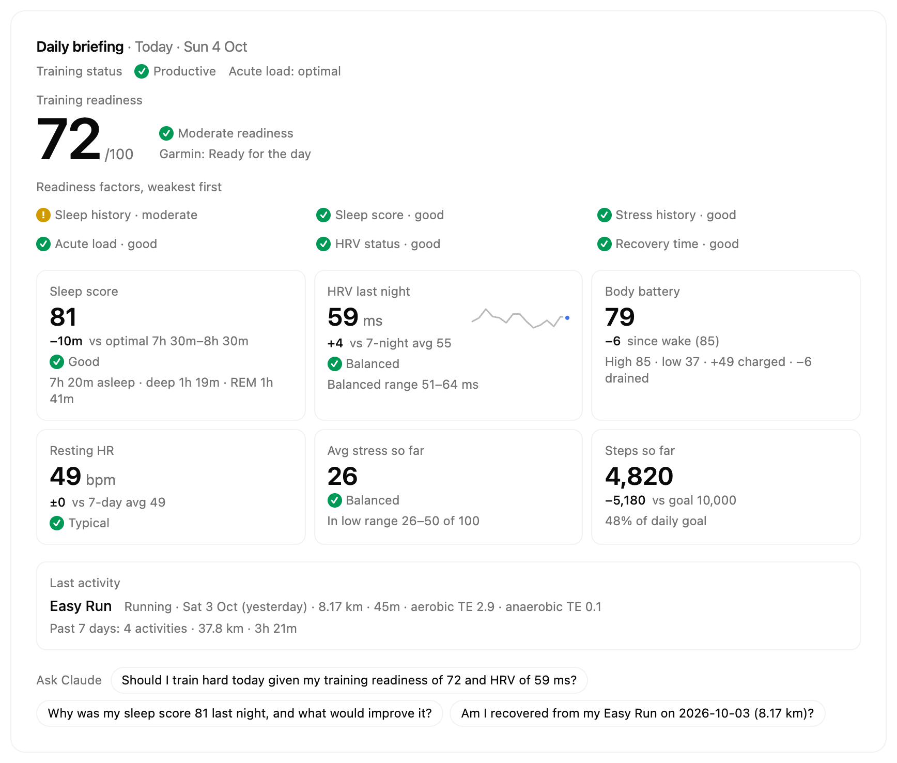
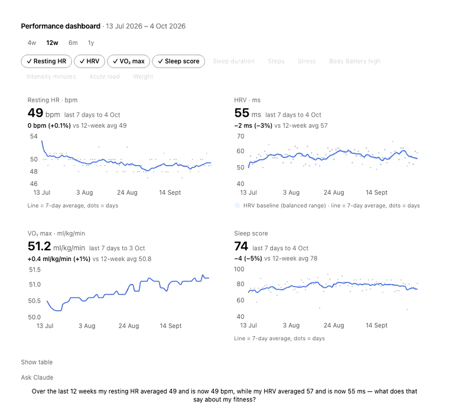
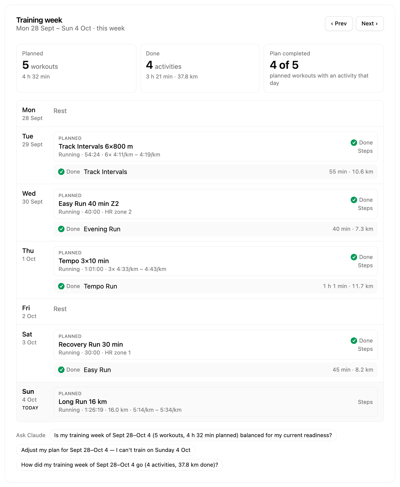
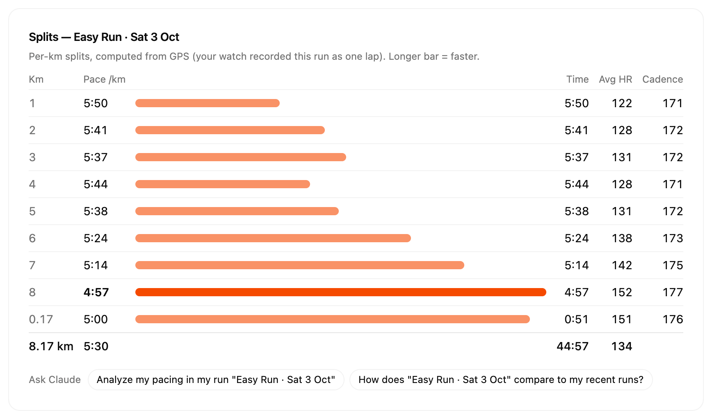

# Run Coach — Garmin MCP App

Connect your Garmin watch to Claude (desktop, web and mobile) or ChatGPT. Explore interactive charts.

<sub>Unofficial. Not affiliated with or endorsed by Garmin. Garmin is a trademark of Garmin Ltd.</sub>

<p align="center">
  
</p>

## Install

### Claude Desktop

1. Download the latest `.mcpb` file from [Releases](https://github.com/chenhunghan/garmin-mcp-app/releases)
2. Drag it into Claude Desktop to install
3. Ask Claude anything about your Garmin data — it will prompt you to sign in on first use

### ChatGPT (desktop app)

Requires Node.js 20+.

1. In the ChatGPT desktop app, open **Settings → Plugins → Add marketplace**
2. **Source:** `chenhunghan/garmin-mcp-app` (leave Git ref and sparse paths empty) → **Add marketplace**
3. Restart the app, open the Plugins Directory, choose the **Run Coach** marketplace and install **Coach**

Or with the [Codex CLI](https://developers.openai.com/codex): `codex plugin marketplace add chenhunghan/garmin-mcp-app` then `codex plugin add garmin@garmin-mcp`.

**Coach** then appears in the sidebar (daily briefing and performance dashboard) and as a **Training Week** tab in conversations; or just ask "@Coach how am I today?". It runs on your computer, so it works in the desktop app only.

### Other MCP clients (Cursor, VS Code, Claude Code, Codex CLI, …)

Requires Node.js 20+. Add the server to your client's MCP config:

```json
{
  "mcpServers": {
    "garmin": { "command": "npx", "args": ["-y", "garmin-mcp-app"] }
  }
}
```

Or from the command line: `claude mcp add garmin -- npx -y garmin-mcp-app` (Claude Code), `codex mcp add garmin -- npx -y garmin-mcp-app` (Codex CLI).

Clients that support [MCP Apps](https://modelcontextprotocol.io/docs/extensions/apps) (e.g. VS Code) show the interactive charts and the sign-in form. Other clients still get every Garmin tool as data, but can't show the sign-in form: sign in once from an MCP Apps client — the tokens are saved in `~/.garminconnect` and shared by every client on your computer.

### Claude web and mobile, ChatGPT web: self-host (free)

Run your own copy on Cloudflare's free Workers plan (no credit card) and add it to Claude or ChatGPT as a custom connector. It's yours alone: only someone with your owner passphrase can connect, and only your Garmin account can sign in.

[](https://deploy.workers.cloudflare.com/?url=https://github.com/chenhunghan/garmin-mcp-app)

1. Click **Deploy to Cloudflare** and sign in (or sign up) to Cloudflare. It copies this repository to your GitHub account and deploys it.
2. Fill in the two secrets it asks for:
   - **OWNER_PASSPHRASE**: a long password only you know. You enter it once when you connect Claude or ChatGPT.
   - **TOKEN_ENCRYPTION_KEY**: encrypts your Garmin sign-in at rest. Generate one with `openssl rand -hex 32`.
3. Open your Worker's address (`https://run-coach.<you>.workers.dev`): the page shows your connector URL, ending in `/mcp`.

**Connect in Claude** (web, desktop or mobile): Settings → Connectors → **Add custom connector**, paste the URL → **Connect** → enter your owner passphrase → sign in to Garmin (and the verification code if Garmin asks). The connector then works on every Claude app where you're signed in, mobile included.

**Connect in ChatGPT** (web): turn on developer mode, add an MCP app with the URL and OAuth, then connect the same way. Whether your ChatGPT plan allows custom MCP servers is up to OpenAI: check its help center.

When Garmin's sign-in expires you never need to reconnect: the app shows its sign-in form, and where it can't, the answer carries a one-time sign-in link (valid 10 minutes).

<details>
<summary>Forgot the passphrase, updating, limits</summary>

- **Forgot the passphrase:** Cloudflare dashboard → your Worker → Settings → Variables and Secrets → update `OWNER_PASSPHRASE`, then connect again.
- **Updating your copy:** in your copy of the repository, `git remote add upstream https://github.com/chenhunghan/garmin-mcp-app` once, then `git fetch upstream --tags` and merge the latest release tag (`git merge garmin-mcp-app-vX.Y.Z`) into `main` and push. Cloudflare redeploys automatically.
- **Free plan limits:** a long-range performance dashboard loads its metrics over several calls, and the 3D replay's real map (elevation and OpenStreetMap) isn't available yet.
- **Debugging:** production stores no logs. `npx wrangler tail` shows live requests; `npm run deploy:dev` deploys a separate `run-coach-dev` Worker with logs on.

</details>

## What you can do

Ask Claude about your health, training, and fitness — it reads your Garmin data and shows interactive charts right in the conversation.

- **Start your day** — a morning briefing: readiness, sleep, HRV, body battery and resting HR against your own baselines, with Claude's suggestions
- **See your trends** — compare up to 4 metrics over 4 weeks to a year, and ask Claude what changed
- **Plan your week** — Claude designs a week of training from your data, then creates and schedules the workouts on your Garmin calendar
- **Analyze your workouts** — per-km splits (even for single-lap runs), HR zones, and training effect
- **Track your fitness** — training readiness, training load, VO2 Max, race predictions, and 30+ more Garmin metrics

### Your Garmin, coached by Claude

The app frames your data against your own baselines; Claude reads it and suggests what to do. Every view has **Ask Claude** questions built from your numbers, and Claude knows what you're looking at.

**Daily briefing** — _"How am I today?"_

<p align="center">
  
</p>

**Performance dashboard** — _"How has my fitness trended this year?"_

<p align="center">
  
</p>

**Weekly training plan** — _"Plan my training week"_ (or the `plan-training-week` prompt)

<p align="center">
  
</p>

**Per-km splits** — _"Show the splits of my last run"_

<p align="center">
  
</p>

<sub>Screenshots use the built-in demo mode (`npm run dev:ui:demo`): a fictional runner, no real person's data. Light and [dark](docs/images/daily-briefing-dark.png) themes follow Claude Desktop.</sub>

What you can visualize

Plot your activities

<p align="center">
  
</p>

Visualize training readiness

<p align="center">
  
</p>
<details>
<summary>Full list of supported Garmin Connect data</summary>

| Category       | Data                                                                                                        |
| -------------- | ----------------------------------------------------------------------------------------------------------- |
| Daily health   | Steps, heart rate, sleep stages, stress, body battery (+ events), HRV, respiration, SpO2, floors, hydration |
| Trends         | Resting heart rate, weekly steps, weekly stress, weekly intensity minutes, weigh-ins                        |
| Activities     | List / by date, details, splits, typed splits, HR time-in-zones, chart data, weather, exercise sets, gear   |
| Training       | Training readiness, training status & load, VO2 Max, race predictions, endurance score, hill score          |
| Performance    | Lactate threshold, cycling FTP, HR zones, fitness age, personal records, running tolerance, progress        |
| Devices & gear | Devices, primary training device, last used device, gear, goals, training plans, calendar                   |
| Workouts       | List, create, update, delete, and schedule workouts                                                         |

</details>

## Privacy & Security

**No data is stored or collected by this app's author.** On your computer (Claude Desktop, ChatGPT desktop, `npx`), your data flows directly between your machine and the Garmin Connect API. Self-hosted, it flows through your own Cloudflare Worker.

<details>
<summary>Learn more</summary>

**On your computer** (`.mcpb`, ChatGPT desktop plugin, `npx`):

- **Your credentials stay private.** You sign in through a secure login form rendered inside Claude Desktop. The login and MFA tools are marked as app-only (`visibility: ["app"]`), meaning Claude (the LLM) cannot call them and **never sees your email, password, or MFA code**.
- **Claude doesn't know who you are.** The LLM only receives the health/fitness data you ask for (steps, sleep, etc.) — it has no access to your Garmin account credentials, OAuth tokens, or profile (name, email, location).
- **Your password is never sent in plain text.** The login form encrypts it with a single-use key before it passes through Claude Desktop, so it can't leak into host logs.
- **Tokens are stored locally.** OAuth tokens are saved on your machine at `~/.garminconnect/` with restrictive file permissions (`0600`). They are never sent anywhere other than the Garmin Connect API.
- **You can log out anytime.** Logging out clears all saved tokens from your machine.

**Self-hosted** (your Cloudflare Worker):

- **Your Worker, your account.** Garmin tokens are encrypted (AES-GCM, with your `TOKEN_ENCRYPTION_KEY`) in a Durable Object in **your** Cloudflare account. The author never sees them.
- **Only you can connect.** Connecting a client needs your owner passphrase (locked for 15 minutes after 5 wrong tries), and after the first sign-in only your Garmin account is accepted.
- **Claude and ChatGPT never see your Garmin password.** You type it on your Worker's own sign-in page or in the app's encrypted form; it's used once and never stored.
- **No stored logs.** Production keeps Cloudflare's logs off; nothing logs requests, tool calls or results. Your data passes through your Cloudflare account.

**Either way:** Run Coach uses Garmin Connect's unofficial API, which can change or break, and using it may conflict with Garmin's terms.

</details>

---

<details>
<summary>Developer / Contributor Guide</summary>

## Getting Started

```bash
git clone https://github.com/chenhunghan/garmin-mcp-app.git
cd garmin-mcp-app
npm install
```

`npm install` automatically sets up git hooks via [prek](https://github.com/j178/prek):

- **commit-msg** — enforces [Conventional Commits](https://www.conventionalcommits.org/) via commitlint
- **pre-push** — runs lint, format check, typecheck, and tests (same as CI)

### Troubleshooting: `core.hooksPath`

If `npm install` warns about `core.hooksPath`, prek cannot install git hooks. Fix it by unsetting the local config:

```bash
git config --unset-all --local core.hooksPath
npm run prepare
```

## Development

```bash
npm run dev        # watch-build server + UI
npm run dev:ui     # standalone UI dev at localhost:5173
npm run test:lib   # run garmin-connect tests
npm run pack       # build + package .mcpb bundle
```

`npm run dev:ui` opens `http://localhost:5173` with the React UI wired to the real MCP server in-process. You can test login, MFA, and logout against the actual Garmin API without deploying to Claude Desktop.

## Testing in Claude Desktop

Run `npm run build` (one-off) or `npm run dev` (watch mode for live rebuilds), then add to `~/Library/Application Support/Claude/claude_desktop_config.json`:

```json
{
  "mcpServers": {
    "garmin-mcp": {
      "command": "node",
      "args": ["/absolute/path/to/garmin-mcp-app/dist/index.js"]
    }
  }
}
```

Restart Claude Desktop. Ask Claude to check your Garmin auth — it will render the app UI in an iframe and run the real login/MFA flow.

## Architecture

- **MCP Server** (`src/server.ts`) — Node.js server over stdio, registers tools + UI resource
- **React UI** (`src/app.tsx`) — Rendered in host's sandboxed iframe, communicates via `postMessage`
- **garmin-connect** (`packages/garmin-connect/`) — TypeScript client library for Garmin Connect OAuth + API
- **Self-hosted Worker** (`src/worker/`) — the same server over Streamable HTTP behind OAuth on Cloudflare Workers (`npm run dev:worker`, `npm run test:worker`); design notes in [`docs/worker-notes.md`](docs/worker-notes.md)

## Commit Convention

Commits must follow the Conventional Commits format:

```
type(optional-scope): description
```

Allowed types: `feat`, `fix`, `chore`, `docs`, `ci`, `refactor`, `test`

</details>

## Disclaimer

Run Coach is an independent, open-source project. It is not affiliated with, endorsed by, or sponsored by Garmin Ltd. or its subsidiaries. Garmin and Garmin Connect are trademarks of Garmin Ltd. or its subsidiaries; they are used here only to describe compatibility. The app uses the unofficial Garmin Connect API with your own account.
